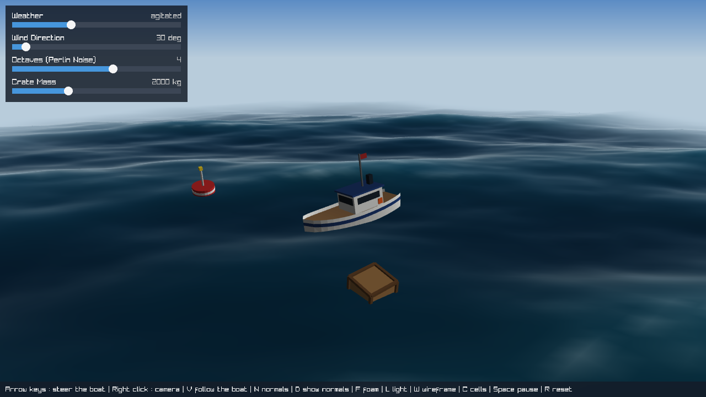

# Real-time ocean & boat buoyancy

Steer a small motorboat through a procedural sea and watch a buoy and a wooden crate respond to the same waves. The surface you see is also the surface the physics samples. Change the weather, pause on a crest, and inspect which parts of the hull are keeping the boat afloat.



**C · raylib 5.5 · GLSL 330 · 120 Hz physics**

## Try it in one minute

1. Set **Weather** near its minimum. Press **C** to display the buoyancy cells, then raise **Crate Mass** and watch the crate settle deeper.
2. Increase **Weather** and press **Space** as a wave passes beneath the bow. The blue cells mark the submerged part of the hull. Press **Space** again to resume.
3. Hold **↑** to accelerate and steer with **← / →**. Drag with the right mouse button to watch the wake from the side.

## How the simulation works

| Component | Implementation |
| --- | --- |
| Ocean surface | Wind-driven swell and layered 3D Perlin noise determine the height of a 201 × 201 vertex grid. The grid moves with the camera target to keep the sea in view. |
| Buoyancy | Each object contains a set of volume cells. For each cell, the program samples `WaterHeightAt(x, z, t)` and estimates its submerged volume. The upward force is **F = ρgV**, where V is the displaced water volume. |
| Boat motion | Each force acts at its cell centre. When a wave lifts one side of the hull more than the other, the resulting torque makes the boat roll or pitch. A semi-implicit Euler step updates motion at 120 Hz. |
| Rendering | Finite differences give the water surface its lighting normals. The shader adds highlights, sky colour and distance fog. Crest foam, a V-shaped wake and bow spray make the boat’s motion visible. |

The ocean is a height field. The wake is a visual effect, and the three objects move independently without collisions.

## Build and run

You need **GCC**, **raylib 5.5** and a graphics driver that supports **OpenGL 3.3**. Run these commands from the directory containing both C files.

**Windows · w64devkit terminal**  
The paths below assume raylib is installed under `C:/raylib`.

```sh
gcc eau_mahe.c bateau_jean.c -o ocean.exe -O2 -IC:/raylib/raylib/src -LC:/raylib/raylib/src -lraylib -lopengl32 -lgdi32 -lwinmm
./ocean.exe
```

**Linux · desktop with X11 and raylib installed**

```sh
gcc eau_mahe.c bateau_jean.c -o ocean -O2 -lraylib -lGL -lm -lpthread -ldl -lrt -lX11
./ocean
```

## Controls

| Input | Action |
| --- | --- |
| ↑ / ↓ · ← / → | Forward / reverse thrust · steer left / right |
| Right mouse drag · scroll wheel | Orbit · zoom |
| V | Toggle boat-follow camera |
| C | Show buoyancy cells |
| N · D | Switch between computed and flat normals · display normal vectors |
| F · L · W | Toggle foam · rotate the light · toggle wireframe |
| Space · R | Pause or resume physics · reset objects |
| Sliders | Adjust weather, wind direction, Perlin octaves and crate mass |

## Authors

Built for *Hands-on 3D Programming* by **Mahé Léhart** and **Jean Catherine**.

- **Mahé Léhart** built the ocean surface, Perlin noise, normals, shader, controls and main loop in [eau_mahe.c](eau_mahe.c).
- **Jean Catherine** built the hull and object meshes, buoyancy cells, force and torque calculations, steering, spray and wake in [bateau_jean.c](bateau_jean.c).

The team used AI to study Perlin noise, Archimedes’ principle and Euler integration, and for assistance with main-loop integration and mesh construction.
